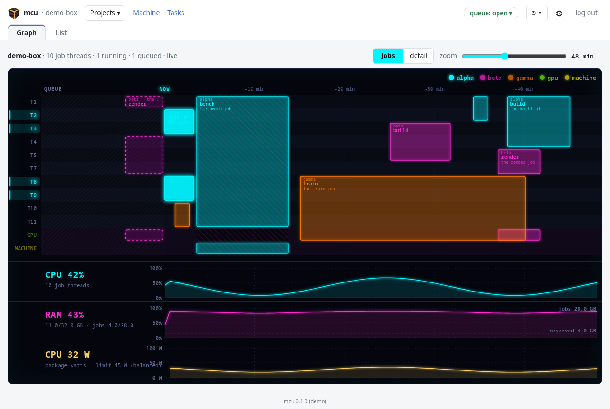

<p align="center"></p>

# mcu

**mcu** (*multiple compute unit*) turns one strong Linux machine into a shared
job box. Several projects, people or AI agents, each with its own SSH key,
send it builds, test suites, benchmarks and GPU work. It runs them in rootless
containers with the threads, memory and devices each job declares, in a fair
queue, with timings you can compare from one run to the next.

It's for a lab, a team or one person with **a machine to dedicate** and several
projects that would otherwise fight over it, or fill a laptop's disk. It is
not a cluster scheduler and not a hosted CI service: one box, run by its
owner, used over SSH.

Each project gets its own Unix user and its own quota, and decides for itself
what it runs, inside limits the owner sets.



<sub>The dashboard in demo mode (`npm run demo`), with made-up projects.</sub>

## Why mcu

Small things that add up when several projects share one box. Each one links
to where the docs explain it.

### Sending jobs

- **Nothing to install on the client.** A key and `ssh … run test` is enough.
  [`mcuctl`](docs/USING.md#mcuctl-the-same-without-ssh-on-the-command-line) adds a
  config file, and an **MCP server** gives agents the same commands as typed
  tools.
- **The docs live on the box.** `docs agents`, `docs <topic>`, and refusals
  that end with the topic explaining them. Agents learn the box from the box,
  at the version it runs ([For agents](docs/USING.md#0-for-agents)).
- **A job says why it waits** ("needs 4 threads, 0 free, held by …;
  position 2; start ~23:53") and when it should start. The estimates come from
  each job's learned run times ([the queue](docs/USING.md#capacity-and-the-queue)).
- **Fair sharing without idle threads.** Jobs run side by side when they fit.
  Backfill lets a small job start early, but only when it delays no one ahead.
  `priority=high|low` orders a project's own jobs.
- **Chains and dependencies.** `run build -- test -- release` runs each step
  after the one before succeeds, and `after=` / `after_ok=` wait on other jobs
  ([chains](docs/USING.md#dependencies-and-chains)).
- **Exit codes that mean something.** `75` means "not now, retry later" and is
  never a test failure. `78` means "this box can never run it as asked". `79`
  means a dependency failed. `137` means the memory limit, and the log says so
  ([exit codes](docs/USING.md#7-exit-codes)).
- **Results without copying.** Fetch them, or read them in place over a
  read-only sshfs view of the job's directory and storage
  ([reading in place](docs/USING.md#reading-in-place-the-projects-view)).
- **`health`** gives the box as an agent sees it: whether it is degraded, the
  queue, and what to do ([health](docs/USING.md#health-the-box-as-an-agent-sees-it)).

### Builds that stay warm

- **Storage persists between runs**, laid out as the project likes: a tree per
  branch (`target/${branch}`), a compile cache shared by every branch
  (sccache), a database's data
  ([storage](docs/USING.md#storage-yours-to-organize)).
- **Every storage says when it ends**: unused for a while, once its branch is
  deleted on the remote, or capped in size. Nothing is left to grow forever.
- **A new branch starts warm.** Its tree begins as a reflink copy of `main`'s,
  which is instant on XFS and btrfs. While a job is writing `main`, the copy
  comes from the snapshot of `main` taken after its last good run.
- **Room is made before a job, not discovered halfway.** The box learns how
  much each job grows the disk. Before a run, it evicts the project's oldest
  unused branch trees, or answers `75` with the figures, instead of failing on
  "No space left on device".
- **Large repositories** are fetched once into a shared cache and checked out
  per job ([checkout](docs/USING.md#large-repositories-checkout)).

### Honest resources

- **Declared, then enforced.** Threads are pinned, memory is limited per
  container, and the GPU and other devices are resources a job names
  ([hardware](docs/USING.md#hardware-resources)).
- **Memory is learned.** After a run, the box reserves what the job really
  needed: anonymous memory and swap, without the page cache. The log line says
  what each figure means, so a project can size `memory =` itself.
- **Services beside a job:** a database or a web server in the job's pod, torn
  down when it ends
  ([services](docs/USING.md#services-a-database-or-a-web-server-beside-a-job)).
- **GUI apps, headless:** a Wayland compositor in the job for screenshots and
  input, on the CPU or the GPU
  ([wbox](docs/USING.md#running-a-gui-app-headless-wbox)).
- **An eGPU you can unplug.** Eject it, and GPU jobs wait or are refused while
  the others go on; attach it again later ([the eGPU](docs/ADMIN.md#the-egpu)).
- **SSD and spinning disks**, each with its own quota per project. A storage
  can ask for `media = "hdd"`, and `config usage` shows what fills which.

### Numbers you can trust

- **Timing jobs run alone** on the machine (`timing = true`). They wait for
  the CPU to cool first and can run under a frequency cap, so the same code
  gives the same time ([timing jobs](docs/USING.md#timing-jobs-timing--true)).
- **Every run says if it is comparable.** Its `conditions.json` records the
  CPU temperature, throttling, the governor and turbo, and the jobs that
  overlapped it, with a verdict
  ([conditions.json](docs/USING.md#timing-jobs-conditionsjson)).

### Safe to share

- **Rootless containers, one Unix user per project**, and no network in jobs:
  only the image build and the fetch step have it.
- **A project only ever sees its own** jobs, storage and results, plus the
  volumes another project shared with it read-only.
- **The threat model is written down**: what mcu protects, from whom, and
  what it does not try to do ([threat model](docs/THREAT-MODEL.md)).

### Running the box

- **A dashboard**: the threads, the GPU and the machine as lanes, the queue,
  the projects, disks and pools, timing and power profiles.
- **Projects manage themselves.** Once invited, a project writes its
  `Benchfile` and sets its own limits inside the box's envelope, with no
  approval step ([who sets what](docs/ADMIN.md#who-sets-what)).
- **Gentle maintenance.** Pause or close the queue with a reason that clients
  see. A restart or power-off closes the queue, ejects the eGPU, waits for the
  running jobs, and counts down. It can be cancelled until the end, or run at
  once when nothing is left running
  ([restart and power-off](docs/ADMIN.md#restart-and-power-off)).
- **`doctor`** says what the machine has and lacks, with the command that
  fixes each item ([checking the machine](docs/ADMIN.md#checking-the-machine)).

## Quick start

**The admin**, on a dedicated Fedora machine (see [docs/INSTALL.md](docs/INSTALL.md)):

```sh
sudo box/mcu-admin doctor          # what the machine has and lacks, with the fixes
sudo make install                  # the files (the dashboard comes built in a release)
sudo box/mcu-admin init            # services, accounts, sudoers, the dashboard
sudo mcu-admin invite myapp        # prints myapp's private key, once
```

**A project**, with the key it was given (see [docs/USING.md](docs/USING.md)):

```sh
ssh -i myapp.key mcu-myapp@box docs agents             # the guide, on the box
ssh -i myapp.key mcu-myapp@box config benchfile < Benchfile
ssh -i myapp.key mcu-myapp@box run test branch=main    # queue a job, follow its log
```

## Documentation

| | |
|---|---|
| [docs/USING.md](docs/USING.md) | for projects: the key, the Benchfile, running jobs, results, limits, exit codes. Also on the box: `docs` |
| [docs/INSTALL.md](docs/INSTALL.md) | a dedicated box from scratch, upgrade, uninstall |
| [docs/ADMIN.md](docs/ADMIN.md) | running a box: projects, the envelope, disks and pools, queue modes, timing, backups |
| [docs/CONFIG.md](docs/CONFIG.md) | the settings and where each value comes from |
| [docs/ARCHITECTURE.md](docs/ARCHITECTURE.md) | the components, who runs as whom, the state on disk, the security boundaries |
| [docs/THREAT-MODEL.md](docs/THREAT-MODEL.md) | what mcu protects, from whom, how, and what it does not try to do |
| [docs/VM.md](docs/VM.md) | running mcu in a virtual machine, and what that costs |
| [docs/reference-box.md](docs/reference-box.md) | one real machine's figures, as a sizing example |

## Status

Version 0.1.0, used daily on one machine. Fedora only for now.

## Naming

The file format keeps its first name, the **Benchfile** (`config benchfile`),
like a Dockerfile. So do the markers it leaves in a project's storage
(`.bench-*`) and the `bench:` prefix of a job's log lines. Everything else is
`mcu`: the commands (`mcu-admin`, `mcu-job`), the users (`mcu-<project>`), the
paths (`/var/lib/mcu`, `/etc/mcu`) and the `MCU_*` variables (`BENCH_*` are
still read for one release).

## License

MIT, see [LICENSE](LICENSE). Third-party notices: [THIRD_PARTY.md](THIRD_PARTY.md).
Contributing: [CONTRIBUTING.md](CONTRIBUTING.md). Security: [SECURITY.md](SECURITY.md).
