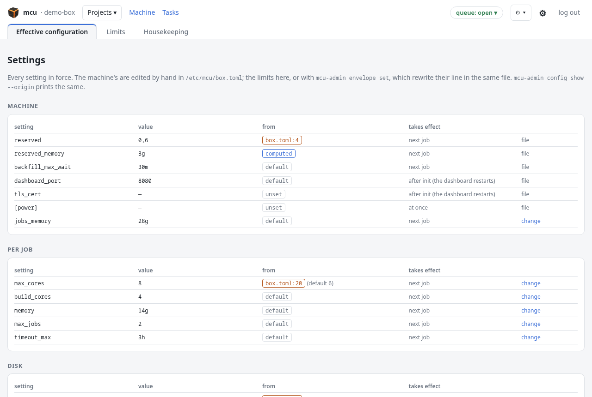
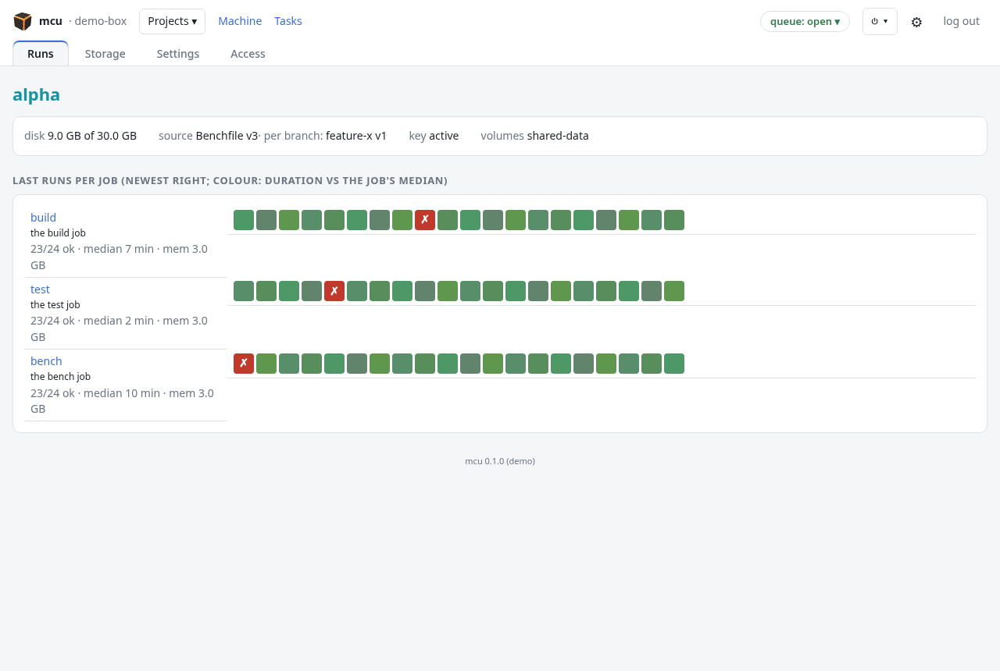
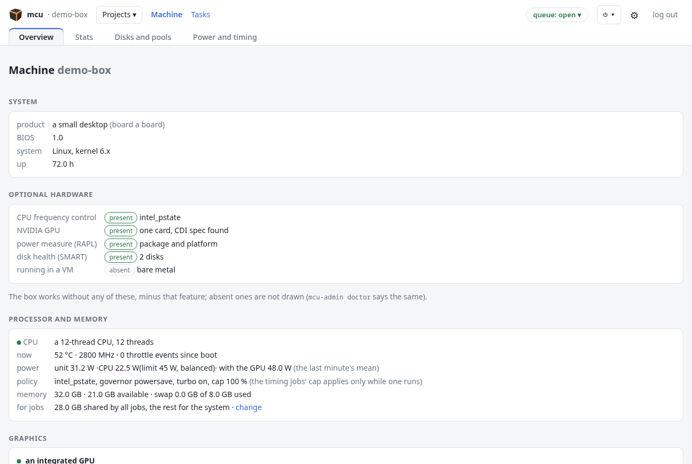

# Running an mcu box

Everything here can be done with `mcu-admin` (as root) or from the dashboard
(`https://<box>:8080`, the admin password). The dashboard calls the same
`mcu-admin` commands. `mcu-admin` with no argument lists them.

## Who sets what



Each setting has one place it lives and one writer:

| setting | writer | where |
|---|---|---|
| the machine: `reserved`, `reserved_memory`, `[resources]`, `[power]`, `[media]`, `dashboard_port`, TLS, `projects_dir`, `backfill_max_wait` | you, by hand | `/etc/mcu/box.toml` |
| the envelope's limits (`[envelope]`, `jobs_memory` and `default_disk` included) | you: the dashboard or `mcu-admin envelope set` | `/etc/mcu/box.toml`, the key's line rewritten |
| the pools | you: the dashboard or `mcu-admin pool` | `/var/lib/mcu/pools.json` |
| a project's repository, manifest and quota | the project: its Benchfile's `[project] disk` when one in use sets it, else `config disk` | its settings |
| a quota override | you, sticky over the project's own | the project's settings |
| the queue's mode | `mcu-admin queue` only (the dashboard, deploys and the shutdown task call it) | `/var/lib/mcu/queue.json` |

`mcu-admin config show --origin` shows each setting in force, where it comes
from and when a change takes effect.

## Projects



```sh
mcu-admin invite <project>       # create it if new, print a new private key (the old one stops working)
mcu-admin revoke <project>       # remove its key; its data stays
mcu-admin list                   # the projects and their settings
mcu-admin quota <project> [ssd|hdd] <size>|none   # your override of its disk quota
mcu-admin cancel <project> <id>|--branch <branch> # cancel its job(s), as it would
```

A project then manages itself through its key: its Benchfile, its quota up
to the envelope's maximum, its volumes and who reads them (`docs/USING.md`).
Your quota override wins over the project's own setting, up to twice the
envelope's `max_disk_ssd`. A project's own quota has one writer: its
Benchfile's `[project] disk` when one in use sets it (then `config disk`
refuses), else `config disk`. A project that set neither follows the
envelope's `default_disk`, including a later change of it.

**Freeing room** when the disk runs short:

```sh
mcu-admin reclaim <project> [reason]          # what it can regenerate: images, tmp storage, results older than 2 days
mcu-admin purge <project> [--volumes] [reason]  # everything but its key, settings and Benchfiles
```

Both are refused while the project has jobs queued or running, and the
project's agent is told.

## The envelope

The limits every project gets, with no approval step: disk, threads and
memory per job, jobs at once, network level, exclusive resources, the longest
timeout, the retention. `mcu-admin envelope` lists them (`config show` adds where each comes from),
`envelope set <key> <value>` changes one, `envelope reset <key>` goes back to
its default. Both, like the dashboard, write `/etc/mcu/box.toml` itself (only
that key's line, a dated backup, the diff in the event log). See
`docs/CONFIG.md`.

## Disks and pools

A pool is a directory on a filesystem with quotas, where projects' data
lives. The default pool takes new projects. Each project's units (each
storage, its results, its images, its volumes) can live on different pools.

```sh
mcu-admin pool list                               # pools, budgets, what each holds
mcu-admin pool add <name> <path>                  # an XFS prjquota filesystem (or a directory on one)
mcu-admin pool budget <pool> <size>               # what the quotas promised there may add up to
mcu-admin pool default <name>
mcu-admin migrate <project> [<unit>] <pool>       # move a unit, or all of them; jobs using it wait
mcu-admin pool retire <name>                      # once empty
```

A pool's type, ssd or hdd, comes from the kernel (rotational) unless set in
`box.toml [media]`. A project's Benchfile may ask for one (`media = "hdd"`).

## The queue

```sh
mcu-admin queue open
mcu-admin queue pause <reason>    # jobs are accepted, none starts; running ones finish
mcu-admin queue close <reason>    # new jobs refused (exit 75, with the reason), none starts
                                  # both take --until 18:30|+30m and --by <who> (shown on the dashboard)
mcu-admin maintenance on <reason> | off   # the same as close / open
mcu-admin status                  # the box at a glance, as JSON
mcu-admin orphans [--stop]        # containers still running after their job ended
```

## Timing and power

**Timing jobs** (`timing = true` in a Benchfile) hold the whole machine and
get the timing profile, so their durations compare from run to run:

```sh
mcu-admin timing                       # the profile
mcu-admin timing cap 65                # a frequency cap while they run (none: full speed)
mcu-admin timing cooldown on target auto   # wait until the CPU cools before they start
```

The cap uses intel_pstate, or cpufreq on other CPUs; a machine with neither
runs timing jobs uncapped, with a cool-down only.

**The CPU's power profile** (RAPL's long-term limit) for every other job:

```sh
mcu-admin power fast | balanced | quiet
```

## The eGPU

On a box with an NVIDIA GPU behind Thunderbolt, eject it before unplugging:

```sh
mcu-admin gpu eject      # GPU jobs wait or are refused; running ones are waited for
mcu-admin gpu attach     # after plugging it back
```

A pull without an eject is noticed too: GPU jobs get exit 75 until it is back.

## Long operations and housekeeping

Moves, reclaims, purges and shutdowns run as tasks, one at a time, with
progress and logs (`mcu-admin task list | show <id> | cancel <id>`, or the
dashboard's Tasks). Job results older than the retention are removed daily
(`mcu-admin prune` now). Storage follows the rules each project declared
(`docs/USING.md`, "What the box keeps between runs").

## Restart and power-off

```sh
mcu-admin shutdown reboot | poweroff   # the queue closes, the eGPU is ejected, running jobs are waited for, then 60 s
mcu-admin shutdown cancel
```

Jobs a crash interrupted end with exit 75 at the next boot, so nobody waits
on them forever.

## Backups

Worth saving:

- `/etc/mcu` (the settings, the dashboard's certificate and password);
- `/var/lib/mcu` (projects' settings and Benchfiles, the state, the learned
  durations and memory);
- the projects' homes' `.ssh` (their public keys), or invite them again;
- the shared volumes (`volumes_dir`), if their content can't be provisioned
  again.

Regenerable, not worth saving: images (rebuilt from the Benchfiles), tmp
storage, job results past what you need.

## Checking the machine



```sh
mcu-admin doctor         # packages, cgroups, SELinux, pools' quotas, services, optional hardware
mcu-admin config show    # every setting in force and its source
```
